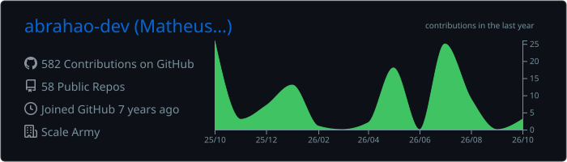
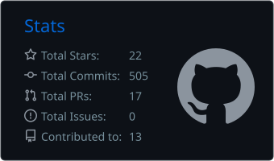
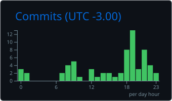
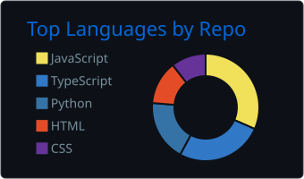
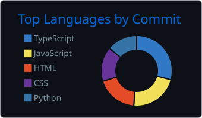

<!-- ═══════════════════════════════  HEADER  ═══════════════════════════════ -->


<div align="center">

<!-- Typing animation -->
<a href="https://www.linkedin.com/in/abrahao-dev">
  
</a>

<br/>

<!-- Social badges -->
[](https://www.linkedin.com/in/abrahao-dev)
[](mailto:contato.matheusabrahao@gmail.com)
[](https://www.upwork.com/freelancers/~01864b8b7d6ba0fbc2)
[](https://x.com/abrahao_dev)
[](https://www.matheusabrahao.com.br)
[](https://www.shopify.com)


</div>

<!-- ═══════════════════════════════  ABOUT  ═══════════════════════════════ -->

## `~/whoami`

```ts
const matheus: ShopifyDeveloper = {
  role:       "Shopify & Shopify Plus Developer",
  focus:      ["CRO", "Speed", "Shopify SEO",
               "Integrations", "Migrations"],
  experience: "6+ years, 10+ countries",
  result:     "+74% sales for a NY retailer",
  merchant:   "$120K+ store built from scratch",
  now:        "Scale Army (Remote, US hours)",
  mindset:    "engineering measured in revenue",
};
```

I'm a **Shopify Developer and Shopify Plus expert**. For more than six years I've built, fixed and scaled Shopify stores for brands in **10+ countries**, usually as the **sole technical owner**, working remotely with US teams.

I sit where engineering meets revenue. I write the Liquid, wire up the integrations and keep the catalog clean, but I measure the work in **sessions, conversion rate and sales**. I've also been the merchant: I scaled my own Shopify store from zero to **$120,000+ in gross sales**, owning development, paid traffic and operations end to end.

<!-- ═══════════════════════════════  WHAT I DO  ═══════════════════════════════ -->

## `~/what-i-do`

| 🧩 | **Focus** | **Details** |
|:---:|:---|:---|
| 🎨 | **Shopify & Shopify Plus Development** | Custom themes, sections and blocks in Liquid, JavaScript, HTML and CSS (OS 2.0, metaobjects) |
| 📈 | **CRO, Speed & Shopify SEO** | Conversion rate optimization, Core Web Vitals and technical SEO that move sessions and sales |
| 🔗 | **Integrations** | Klaviyo, Bazaarvoice, Contentsquare, Tidio, GA4, Microsoft Clarity and custom API work |
| 🚚 | **Migrations & Payments** | Platform migrations to Shopify, Shopify Payments rollouts, multi-location inventory |
| 📦 | **Catalog & Operations** | Inventory and product data synced across 7+ sales channels with Python and Matrixify |
| 📧 | **Klaviyo & Paid Traffic** | Email/SMS flows and segmentation, plus Google Ads and Meta Ads |
| 🤖 | **AI for Commerce** | AI support agents, knowledge base curation and LLM-powered commerce tooling |

<!-- ═══════════════════════════════  TECH STACK  ═══════════════════════════════ -->

## `~/tech-stack`

**Commerce & Platform**


**Languages**


**Frameworks & Runtime**


**Data & Cloud**


**Tooling**


<!-- ═══════════════════════════════  HIGHLIGHTS  ═══════════════════════════════ -->

## `~/highlights`

<div align="center">

| 📈 Client Sales | 🚀 Client Sessions | 💰 Own Store | 🌍 Reach |
|:---:|:---:|:---:|:---:|
| **+74%** total sales | **+455%** sessions | **$120K+** gross sales | **10+** countries |

</div>

- 📈 Grew a **New York fashion retailer's** store by **+455% sessions, +114% orders and +74% total sales** through Shopify SEO, site speed, merchandising and integrations
- 🏆 Scaled a store from scratch to **$120,000+ in gross sales** (~300K sessions, 1,900+ orders), owning development, paid traffic and operations
- 💳 Led a **Shopify Plus** brand's migration of card processing to **Shopify Payments**
- ⭐ Fixed a broken legacy reviews integration that was hiding ratings on **more than half** of the reviewed catalog
- 🔄 Keep inventory and product data in sync across **7+ sales channels** with Python automation and Matrixify
- 🏢 Founded [NEX Agency](https://nexagency.com.br), a Shopify agency serving clients in the US, Canada, Europe and Latin America
- 🍎 Swift Student Challenge 2026 Winner (Apple) · B.S. in Software Engineering, Universidade São Francisco

<!-- ═══════════════════════════════  FEATURED WORK  ═══════════════════════════════ -->

## `~/featured-work`

| Project | What it is | Stack |
|:---|:---|:---|
| [**venna-shopify-theme**](https://github.com/abrahao-dev/venna-shopify-theme) | Shopify OS 2.0 theme with reusable sections, blocks and Shopify CLI workflow | Liquid · JS · CSS |
| [**martina4shop-theme**](https://github.com/abrahao-dev/martina4shop-theme) | Production theme behind Martin4Shop, the store I scaled to $120K+ | Liquid · JS · CSS |
| [**martin-autofulfill**](https://github.com/abrahao-dev/martin-autofulfill) | Shopify order fulfillment automation across Shopify and Shopee: orders, addresses, tracking | Python · Streamlit · Playwright |
| [**ehr-integration**](https://github.com/abrahao-dev/ehr-integration) | Internal tool that maps and submits data to multiple EHR systems, with API and architecture docs | TypeScript · Node.js |
| [**podium-app**](https://github.com/abrahao-dev/podium-app) | Spatial canvas to orchestrate AI coding agents, the tooling I use to ship faster | Tauri · React · Rust |
| [**abrahao-labs-chatbot**](https://github.com/abrahao-dev/abrahao-labs-chatbot) | RAG chatbot for marketing support, the same idea behind AI support agents for stores | Python · LangChain |

<!-- ═══════════════════════════════  GITHUB STATS  ═══════════════════════════════ -->

## `~/github-stats`

<div align="center">









<br/>


<br/>


</div>

<!-- ═══════════════════════════════  SNAKE  ═══════════════════════════════ -->

## `~/contribution-snake`

<div align="center">

<picture>
  <source media="(prefers-color-scheme: dark)" srcset="https://raw.githubusercontent.com/abrahao-dev/abrahao-dev/output/github-snake-dark.svg" />
  <source media="(prefers-color-scheme: light)" srcset="https://raw.githubusercontent.com/abrahao-dev/abrahao-dev/output/github-snake.svg" />
  
</picture>

</div>

<!-- ═══════════════════════════════  HOW I WORK  ═══════════════════════════════ -->

## `~/how-i-work`

```bash
$ matheus --principles
> Own the store end to end.
> Ship for real outcomes:
  conversion · revenue · retention.
> Build code that survives
  the next campaign.
> Structure & accountability (EOS).
> Async. Remote. US hours. On time.
```

<!-- ═══════════════════════════════  CONNECT  ═══════════════════════════════ -->

## `~/lets-connect`

If you're **building on Shopify**, need a **faster, higher-converting store** or a **clean migration**, let's talk.

<div align="center">

[](https://www.linkedin.com/in/abrahao-dev)
[](https://www.upwork.com/freelancers/~01864b8b7d6ba0fbc2)
[](mailto:contato.matheusabrahao@gmail.com)

<br/>


</div>
